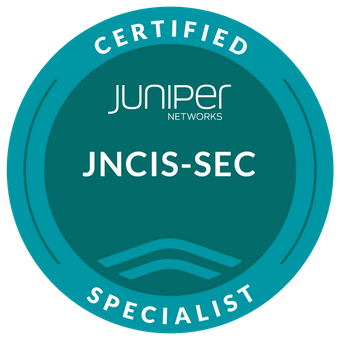
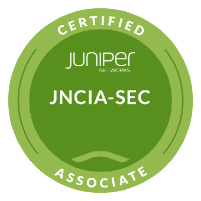
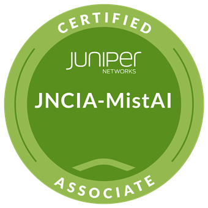
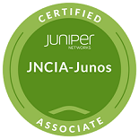
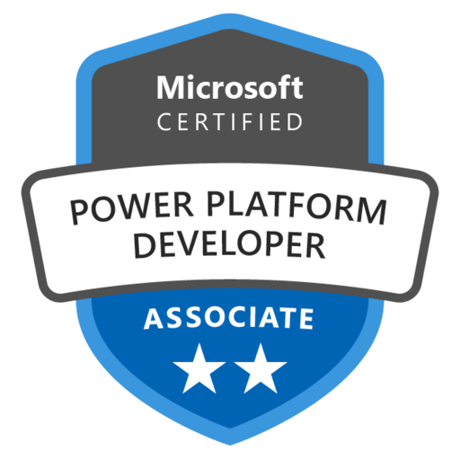
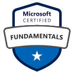

## Juniper Networks Certified Specialist, Security (JNCIS-SEC)

2026 JAN

[Verify JNCIS-SEC on Credly](https://www.credly.com/badges/2370b2bc-e2b8-4be8-8b75-8cb75939512b)

## Juniper Networks Certified Associate, Security (JNCIA-SEC)

2026 JAN

[Verify JNCIA-SEC on Credly](https://www.credly.com/badges/c206b190-16b7-41ec-a949-1cb96082ca24)

## Juniper Networks Certified Associate, Mist AI (JNCIA-MistAI)

2025 AUG

[Verify JNCIA-MistAI on Credly](https://www.credly.com/badges/87318a66-b65e-4401-97fe-40635adffb14)

## Juniper Networks Certified Associate, Junos (JNCIA-Junos)

2025 MAY

[Verify JNCIA-Junos on Credly](https://www.credly.com/badges/858e4f1f-781c-4a29-9eb2-0675529f72d7)

## Microsoft Certified: Power Platform Developer Associate (PL-400)

2024 SEPT

[Verify PL-400 on Microsoft Learn](https://learn.microsoft.com/en-us/users/victorwitkamp-3261/credentials/6fb6277ef8c4af7d)

## Microsoft 365 Certified: Fundamentals (MS-900)

2023 FEB

[Verify MS-900 on Microsoft Learn](https://learn.microsoft.com/en-us/users/victorwitkamp-3261/credentials/abb6a40714512066)

